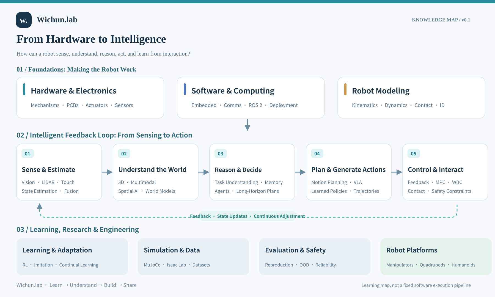

# Wichun.lab

**From Hardware to Intelligence**

*An evolving open learning journal on robotics, control, and embodied intelligence.*

[简体中文](README.zh-CN.md) · [Knowledge Map](docs/ROADMAP.md) · [Notes](notes/README.md) · [Papers](papers/README.md) · [Labs](labs/README.md)

## Why this project?

**How can a physical robot learn to sense, understand, reason, act, and improve through interaction?**

This project explores that question from mechanical and electronic systems through software, robot modeling, perception, control, learning, and higher-level intelligence.

The principle is simple: **understand first, verify when possible, then share**. This is a growing collection of research notes and experiments, not a finished textbook.

## The knowledge map

[Read the roadmap](docs/ROADMAP.md) · **[Explore the detailed Knowledge Atlas v0.2](docs/KNOWLEDGE-ATLAS.md)** · [中文版知识地图](assets/knowledge-map-v0.1-zh.svg)

The diagram is a **learning guide**, not a fixed software architecture. Different algorithms and systems can span multiple stages.

## What you'll find

| Section | Scope | Status |
| --- | --- | --- |
| [Roadmap](docs/ROADMAP.md) | Main ideas, technical connections, and learning directions | **v0.1 published** |
| [Notes](notes/README.md) | Concepts, equations, and detailed tutorials | In progress |
| [Papers](papers/README.md) | Source-linked readings, method comparisons, and open questions | In progress |
| [Labs](labs/README.md) | Reproducible code, simulations, configurations, and results | In progress |

The main practice platforms are **manipulators, quadrupeds, and humanoids**. Other robots will appear when they help explain general ideas.

## How it grows

1. **Map the landscape** — understand how hardware, software, and intelligence connect.
2. **Go deep** — begin with control and robot learning, then expand systematically.
3. **Verify through experiments** — document versions, methods, limitations, and results.
4. **Open and improve** — share learning material that can be read, reused, and corrected.

Safety, reliability, human–robot interaction, and continual learning are cross-cutting topics.

## Contributions and rights

Corrections, references, and reproducibility suggestions are welcome. See [CONTRIBUTING.md](CONTRIBUTING.md).

This project is at an early stage; planned materials are clearly labeled. An explicit content/software license has not been selected yet. Third-party papers, data, figures, and code retain their own rights.

---

Maintained by [Wichun](https://github.com/wenyu-robot) · Learn → Understand → Build → Share

