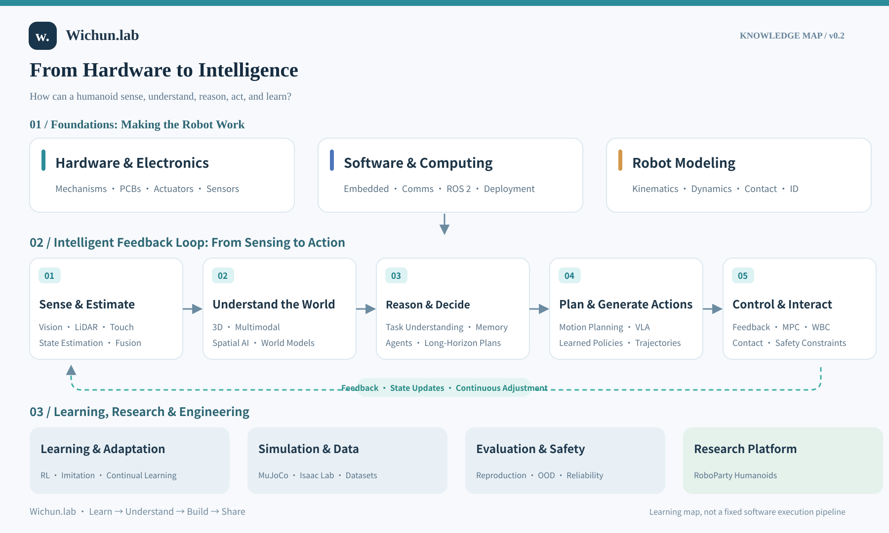

# Wichun.lab

**From Hardware to Intelligence**

An open learning and research journal built around RoboParty humanoid robots.

[简体中文](README.zh-CN.md) · [Start here](docs/ROBOPARTY.en.md) · [Knowledge Atlas](docs/KNOWLEDGE-ATLAS.md) · [Notes](notes/README.md) · [Papers](papers/README.md) · [Labs](labs/README.md)

## The central question

**How does a humanoid robot progress from physical hardware to sensing, understanding, decisions, action and autonomous learning?**

The first edition follows RoboParty's open materials: mechanisms, actuators and electronics; firmware, communication and robot models; motion control, perception, learning and autonomous tasks. Explanations, source analysis, paper readings and experiments will connect these layers on a common robot platform.

**Understand first, then share.** This is a long-term learning and research project, revised as evidence grows.

## First-edition scope and starting point

- **Platform family:** humanoid robots, focused on RoboParty.
- **Source entries:** [RP1](https://github.com/Roboparty/RP1) for the platform and subsystems, [ROBOTO_ORIGIN / RPO](https://github.com/Roboparty/roboto_origin) for prototype context, and [Party_OS](https://github.com/Roboparty/Party_OS) for capability research and its roadmap.
- **Version boundary:** the first experiment's exact robot configuration and upstream commits have not been selected. Each experiment must record matching hardware, models, code, data and policy versions.
- **Current status:** a knowledge framework and source guide are available. Detailed tutorials, paper readings and reproduced experiments are still planned. Public availability, robot support and local verification are tracked separately.

**Begin with the [RoboParty source guide](docs/ROBOPARTY.en.md).** The next planned output is a humanoid system anatomy: follow one joint through mechanics, motor and driver, communication, state feedback and commands.

## Knowledge map

[Read Knowledge Atlas v0.3](docs/KNOWLEDGE-ATLAS.md) · [中文版地图](assets/knowledge-map-v0.2-zh.svg)

This map explains functional questions and their connections. Learning, world models and VLA can span several functions. Research directions shown here are not claims of capabilities released by RoboParty or implemented in this repository.

## How the content grows

| Section | Scope | Status |
| --- | --- | --- |
| [RoboParty guide](docs/ROBOPARTY.en.md) | Official sources, subsystem mapping and verification boundaries | Initial guide |
| [Knowledge Atlas](docs/KNOWLEDGE-ATLAS.md) | Body, software and models through motion, perception and autonomous tasks | v0.3 |
| [Notes](notes/README.md) | Principles, derivations, source and system analysis | Planned |
| [Papers](papers/README.md) | Problems, methods, evidence and platform relevance | Planned |
| [Labs](labs/README.md) | Runnable configurations, evaluation, failures and reproduction records | Planned |

Each topic should connect **question → upstream evidence → principles and code → experiment → results and limitations**. Motion skills, perception-driven behavior and autonomous tasks require separate evaluation criteria.

## Contributions and rights

Corrections, primary references and experiment suggestions are welcome. See [CONTRIBUTING.md](CONTRIBUTING.md).

This is an independently maintained project, with no official affiliation or partnership with RoboParty. Upstream projects retain their attribution and applicable licenses; consult each repository and version. A license for Wichun.lab's own material has not yet been selected. Third-party papers are managed mainly through links and citations.

---

Maintained by [Wichun](https://github.com/wenyu-robot) · Learn → Understand → Build → Share

