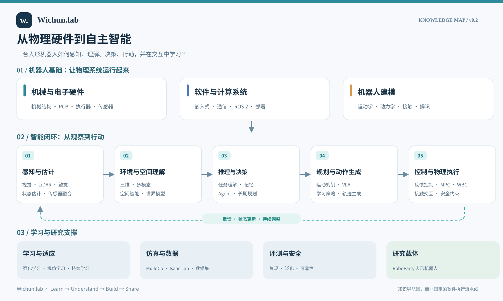

# Wichun.lab

**From Hardware to Intelligence · 从物理硬件到自主智能**

以 RoboParty 人形机器人为载体的开放学习与研究记录。

[English](README.md) · [从这里开始](docs/ROBOPARTY.md) · [知识全景](docs/KNOWLEDGE-ATLAS.zh-CN.md) · [学习笔记](notes/README.md) · [论文阅读](papers/README.md) · [实验代码](labs/README.md)

## 核心问题

**一台人形机器人如何从物理硬件出发，逐步具备感知、理解、决策、行动和自主学习的能力？**

第一版围绕 RoboParty 的开源内容展开：从结构、执行器和电气系统，到固件、通信、机器人建模、运动控制，再到感知、学习和自主任务。通过原理笔记、源码分析、论文阅读和实验，连接同一台机器人的不同层次。

**先真正理解，再整理分享。** 这是长期学习与研究项目，内容会持续修订。

## 第一版范围与入口

- **研究载体：** 人形机器人。第一版集中研究 RoboParty。
- **资料入口：** [RP1](https://github.com/Roboparty/RP1) 用于梳理平台与子系统，[ROBOTO_ORIGIN / RPO](https://github.com/Roboparty/roboto_origin) 用于原型平台背景，[Party_OS](https://github.com/Roboparty/Party_OS) 用于追踪能力研究与演进路线。
- **版本边界：** 尚未锁定首个实验的具体机型配置与上游提交。每次实验必须记录匹配的硬件、模型、代码、数据与策略版本。
- **当前进度：** 已有知识框架和资料导航；暂无已完成的专题教程、论文解读或实验复现。资料公开、机型支持和本项目验证分别记录。

**建议先读 [RoboParty 资料导航与研究起点](docs/ROBOPARTY.md)。** 下一份计划成果是《RoboParty 人形机器人系统解剖》：追踪一个关节从机械结构、电机与驱动、通信到状态反馈和控制指令的完整链路。

## 知识地图

[阅读知识全景 v0.3](docs/KNOWLEDGE-ATLAS.zh-CN.md) · [English map](assets/knowledge-map-v0.2-en.svg)

地图用于理解问题及联系。学习、世界模型、VLA 等方法可以跨越多个环节；图中的研究方向不代表 RoboParty 已发布或本项目已实现的能力。

## 内容怎样积累？

| 板块 | 内容 | 状态 |
| --- | --- | --- |
| [RoboParty 导航](docs/ROBOPARTY.md) | 官方入口、子系统对应关系、版本与验证边界 | 初版已整理 |
| [知识全景](docs/KNOWLEDGE-ATLAS.zh-CN.md) | 从身体、软件与模型到运动、感知和自主任务 | v0.3 |
| [学习笔记](notes/README.md) | 原理、推导、源码与系统分析 | 计划中 |
| [论文阅读](papers/README.md) | 研究问题、方法、证据及与平台的关系 | 计划中 |
| [实验代码](labs/README.md) | 可运行配置、评测、失败分析与复现记录 | 计划中 |

每个专题尽量形成同一条链路：**问题 → 上游依据 → 原理与代码 → 实验 → 结果与局限**。运动技能、感知驱动行为和自主任务分别定义指标。

## 关于贡献与版权

欢迎纠错、补充原始资料和提出实验建议。详见 [CONTRIBUTING.md](CONTRIBUTING.md)。

本项目独立维护，与 RoboParty 无隶属或官方合作关系。上游项目保留各自署名与许可，具体内容以对应仓库和版本为准。Wichun.lab 自身正式许可尚待确认；第三方论文主要通过链接与引用信息管理。

---

由 [Wichun](https://github.com/wenyu-robot) 持续维护 · Learn → Understand → Build → Share

