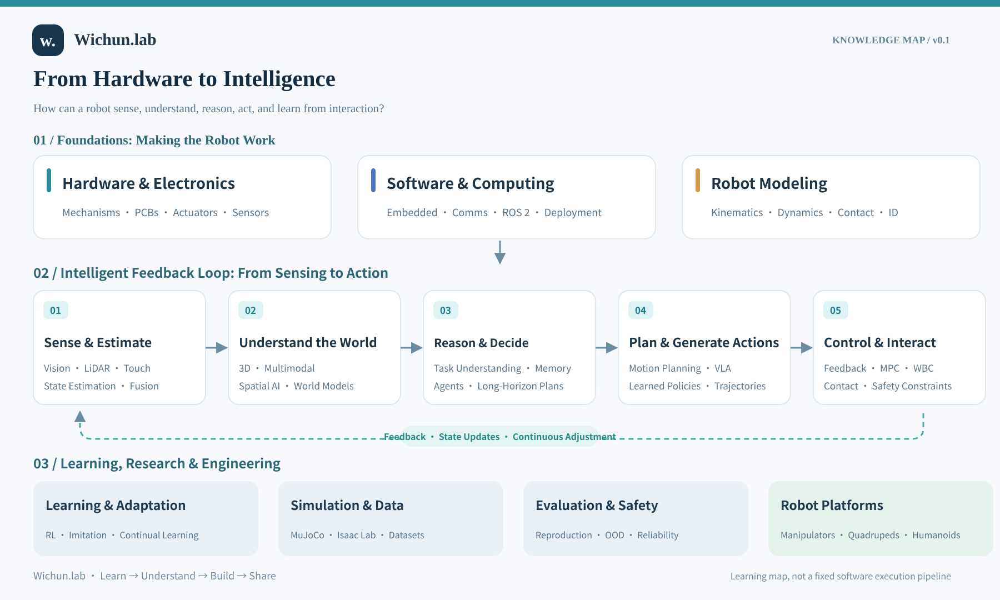

# Knowledge map · v0.1

[中文](ROADMAP.zh-CN.md) · [Home](../README.md)

## Central question

How does a robot connect its physical body with sensing, understanding, reasoning, action, and learning?

### 1. Physical and system foundations
- **Hardware:** mechanisms, PCBs, actuators, sensors, and power.
- **Software:** embedded programming, communication, robotics middleware, deployment.
- **Modeling:** kinematics, dynamics, contact, and system identification.

### 2. The intelligent feedback loop
- **Sense and estimate:** state estimation using vision, LiDAR, tactile and proprioceptive signals.
- **Understand the world:** geometric and semantic representations, multimodal learning, spatial intelligence, world models.
- **Reason and decide:** task interpretation, memory, agents, long-horizon decisions.
- **Plan and generate actions:** motion planning, VLA, learned policies, and trajectories.
- **Control and interact:** feedback control, MPC, WBC, safety, contact with the real world.

This is a **conceptual learning map**, not a universal sequence of software modules. Some methods span several functions. World models can support planning or training; VLA policies can generate actions directly.

### 3. Research and engineering support
- Data collection, datasets, training, and continual adaptation.
- Simulation, reproducibility, sim-to-real, and deployment.
- Evaluation, reliability, safety, and human–robot interaction.
- Main practice platforms: manipulators, quadrupeds, and humanoids.

**Status:** overview v0.1 available; detailed modules, paper readings, and experiments are in preparation.
