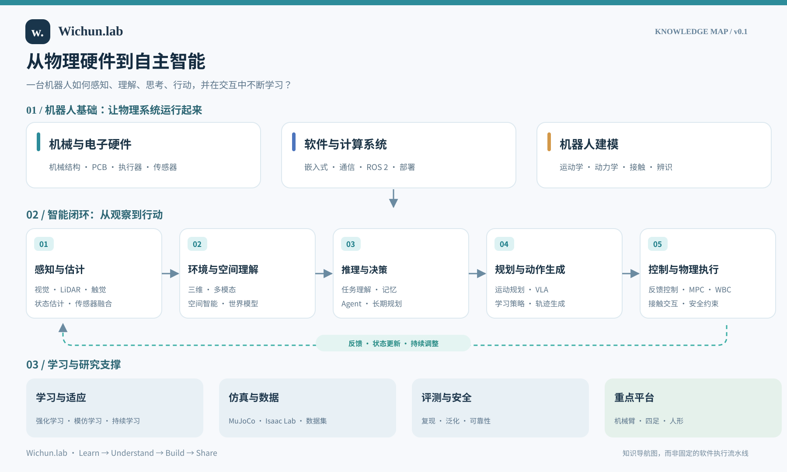

# 具身智能知识全景 · v0.1

[English](ROADMAP.md) · [返回中文首页](../README.zh-CN.md)

## 核心问题

一台机器人如何从物理硬件出发，逐步具备感知、理解、思考、行动和自主学习的能力？

### 1. 物理与系统基础
- **硬件：** 机械设计、PCB、执行器、传感器、供电。
- **软件：** 嵌入式开发、通信、机器人软件和算法部署。
- **建模：** 运动学、动力学、接触、系统辨识。

### 2. 智能闭环
- **感知与估计：** 从视觉、LiDAR、触觉和本体传感器估计状态。
- **环境与空间理解：** 三维几何、语义、多模态、空间智能与世界模型。
- **推理与决策：** 任务理解、记忆、Agent、长时序任务规划。
- **规划与动作生成：** 运动规划、学习策略、VLA、动作和轨迹生成。
- **控制与交互：** 反馈控制、MPC、WBC、安全约束与物理接触。

这是一条**用于学习的概念主线**，并非所有机器人的固定软件执行流程。世界模型可以用于规划或训练，VLA 可能直接产生动作，强化学习也不一定作为实时闭环中的独立模块。

### 3. 学习与工程支撑
- 数据采集、数据集、模型训练和持续适应。
- 仿真、复现、Sim-to-Real 与部署。
- 评测、安全、可靠性和人机交互。
- 机械臂、四足与人形是重点实验平台。

## 如何使用

先建立全局认知，再优先从已有基础的控制、运动控制与机器人学习深入。之后逐步填充各领域的概念、推导、论文、代码与实验记录。

**当前状态：** 已发布第一版知识地图；详细教程、论文精读与实验仍在建设中。
